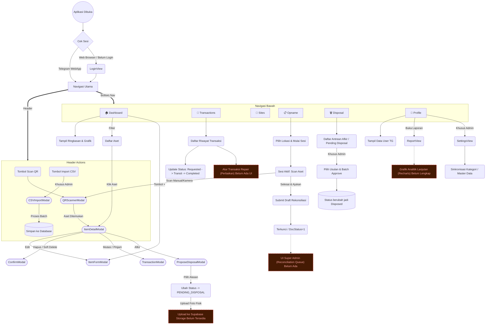

# 🗺️ Peta Alur Navigasi & Proses E1-TMA

Berikut adalah diagram alur komprehensif dari semua menu dan antarmuka di dalam aplikasi. Kotak berwarna kuning/merah menandakan area yang alurnya masih terputus atau belum diimplementasikan sepenuhnya.

---

## ⚠️ Daftar Alur yang Terputus / Menggantung (Pending Finishing)

Berdasarkan analisis *system health check*, berikut adalah fitur-fitur yang logika *backend*-nya sebagian besar sudah ada atau direncanakan di BRD, namun **alur di layar (UI) belum rampung atau terputus**:

### 1. Antrean Persetujuan Rekonsiliasi Opname (Super Admin)
- **Status:** 🔴 Terputus Sepenuhnya.
- **Kondisi:** Saat ini, di halaman `OpnameView`, teknisi/auditor sudah bisa menekan tombol **"Ajukan Rekonsiliasi"** ke pusat. Dokumen tersebut sukses tersimpan di database (`stock_reconciliations` status = Submitted).
- **Masalah:** **TIDAK ADA HALAMAN** untuk Super Admin melihat daftar rekonsiliasi tersebut, mengecek selisihnya, dan menekan tombol *Approve*. Fungsi API-nya (`approveReconciliation` di `opnameService.ts`) sudah ditulis, tapi *UI-nya sama sekali belum dibuat*.

### 2. Lampiran Foto Fisik Aset saat Pengusulan Disposal
- **Status:** 🟠 Menggantung (Bisa dipakai tanpa foto, tapi melanggar tata kelola audit).
- **Kondisi:** Halaman `ProposeDisposalModal` sudah bisa dipakai untuk mengusulkan pembuangan barang yang rusak (Afkir). Di skema database, ada kolom `photo_url` untuk melampirkan bukti fisik kerusakan.
- **Masalah:** Di dalam UI *modal* pengajuan tersebut, belum ada tombol/fitur unggah (*upload file/camera*) untuk foto ke Supabase Storage. Pengajuan hanya berupa teks alasan saja.

### 3. Alur Transaksi "Repair" (Perbaikan)
- **Status:** 🟠 Belum Tersedia.
- **Kondisi:** Aplikasi ini dirancang untuk Mutasi (Pindah) dan Peminjaman (Borrow). Skema database sebenarnya sudah mendukung `transaction_type = 'Repair'`.
- **Masalah:** Belum ada form khusus atau logika antarmuka untuk mencatat pengiriman barang rusak ke pihak vendor/pihak ke-3, estimasi harga perbaikan, dan waktu selesainya.

### 4. Edge Function: Notifikasi "Overdue" (Jatuh Tempo Peminjaman)
- **Status:** 🟠 Tertunda.
- **Kondisi:** Aplikasi sudah berhasil mengirim notifikasi ke bot Telegram saat barang dikirim (*In Transit*). Namun, jika barang dipinjam dan batas waktunya (*Due Date*) lewat, tidak ada yang mengingatkan.
- **Masalah:** *Cron-job* harian (Supabase Edge Function) yang berfungsi untuk mengecek daftar peminjaman terlambat dan mengirimkan notifikasi *alert* ke Telegram belum ditulis/diaktifkan.

### 5. Halaman Laporan (Report View / Analytics)
- **Status:** 🟡 Sedang Berjalan / Sangat Standar.
- **Kondisi:** Tombol ke menu Laporan (di dalam tab Profile) sudah ada.
- **Masalah:** Mengacu pada BRD, manajemen ingin melihat tren pergerakan aset dan utilisasi lokasi (menggunakan *library* Recharts). Halaman saat ini masih berupa *placeholder* kosong atau sangat dasar.

---
**Tindakan Lanjutan:**
Apakah Anda ingin kita menyelesaikan **Alur Persetujuan Rekonsiliasi (Nomor 1)** terlebih dahulu agar alur Audit/Opname bisa dibilang *End-to-End* komplit?
